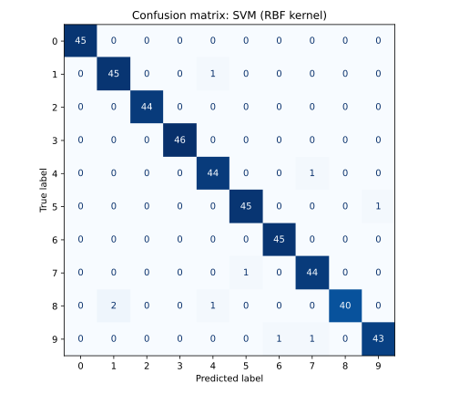
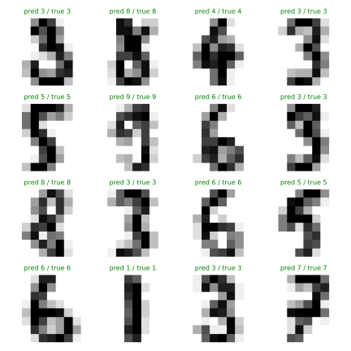

# Handwritten Digit Classification (Computer Vision)

Classifies images of handwritten digits (0-9) using classic machine learning and a small neural network.

## Dataset
UCI "Optical Recognition of Handwritten Digits", bundled with scikit-learn: 1,797 grayscale images, 8x8 pixels, 10 classes. No download needed.

## What it does
1. Loads the images and splits them 75% train / 25% test (stratified, fixed seed 42).
2. Trains three models: Logistic Regression, SVM (RBF kernel), and a Multi-Layer Perceptron (neural network, 128-64 hidden units). Pixels are standardized first.
3. Evaluates on the 450 held-out test images.
4. Saves a confusion matrix, 16 sample predictions, and `results.json`.

## Results (from `run_output.txt`, one run on this machine)
| Model | Test accuracy |
|---|---|
| Logistic Regression | 97.78% |
| SVM (RBF kernel) | **98.00%** |
| Neural network (MLP) | 97.33% |

Weakest class for the best model: digit 8 (recall 0.93). See the figures below (also saved as PNG when you run the script).

## How to run
```bash
pip install -r requirements.txt
python classify.py
```
Tested with Python 3, scikit-learn 1.7.2, numpy 2.2.6, matplotlib 3.10.9.

## Limits
The images are tiny (8x8) and clean, so high accuracy is expected. This is a learning project, not a production OCR system. A next step would be a CNN on MNIST (28x28).

## Figures



